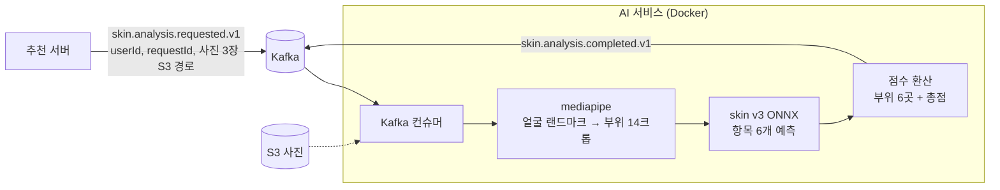
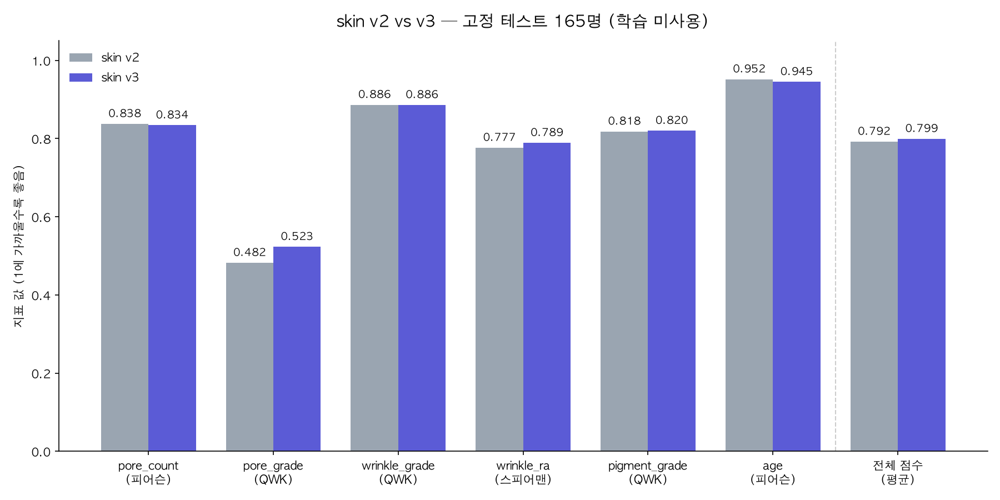

# seoulection-skin-analysis

**얼굴 사진 3장(정면·좌·우)으로 피부 상태를 점수화하는 자체 AI 모델과 그 서빙·재학습 코드.**
MySeoulection(해외 소비자 대상 K-뷰티 추천)의 피부분석 단계에서 쓰던 유료 API(AILabTools)를 대체한다.

| | |
|---|---|
| 입력 | 사용자 사진 3장 (S3 경로, Kafka 이벤트) |
| 출력 | 총점·부위 6곳 점수(0~100), 모공·주름·색소 측정값, 피부 나이 |
| 모델 | **skin v3** — ConvNeXt-Tiny + CORAL 순서형 헤드|
| 학습 데이터 | AI-Hub 한국인 피부상태 측정 데이터 965명 (전문가·측정기 라벨) |
| 운영 | AWS 프라이빗 EC2의 Docker 컨테이너 1개, 2026-10-20부터 운영 중 |

## 동작 방식



1. 추천 서버가 사진을 S3에 올리고 `requested` 이벤트를 보낸다.
2. 서비스가 사진을 받아 이마·미간·눈가 좌우·볼 좌우 6부위를 잘라낸다. 오른쪽 부위는 좌우 반전해 같은 모델에 넣는다.
3. 모델이 부위별로 모공 개수·모공 등급·주름 등급·주름 깊이(Ra)·색소 등급·나이를 예측한다.
4. 측정값을 0~100점으로 바꿔 `completed` 이벤트로 돌려준다. 실패하면 `NO_FACE`, `LOW_QUALITY` 같은 사유를 담는다.

같은 프로세스에 테스트용 HTTP API(`POST /analyze`, `GET /health`)도 있다. 메시지 형식은 [serving/service.py](serving/service.py), 점수 공식은 [serving/scoring.py](serving/scoring.py) 맨 위에 있다.

## 성능

학습에 쓰지 않은 **고정 테스트 165명**으로 평가했다. 165명은 AILabTools와 비교할 때 쓴 사람들과 같다.



- 지표는 등급 항목이 QWK, 숫자 항목이 피어슨·스피어맨 상관계수이고 1에 가까울수록 좋다. 전체 점수는 6개의 평균이다.
- v3는 v2와 정확도가 비슷하면서 파라미터가 약 절반이고, CPU 추론이 약 2배 빠르다. 그래서 운영 모델을 v3로 바꿨다.

## 폴더 구조

| 폴더 | 내용 |
|---|---|
| [serving/](serving/) | 운영 서비스. Kafka 컨슈머 + FastAPI, S3 다운로드, 점수 환산 |
| [common/](common/) | 학습과 서빙이 **같이 쓰는** 전처리: 부위 크롭, 정규화, 예측값 해석 |
| [training/](training/) | 학습 → ONNX 내보내기 → 고정 테스트셋 평가 |
| [scripts/](scripts/) | 데이터 준비(AI-Hub → 크롭 데이터셋), 테스트 분할, S3 업로드, Kafka 테스트 메시지 |
| [pipelines/](pipelines/) | 재학습 자동화: SageMaker 파이프라인 + Prefect 주간 스케줄 |
| [configs/](configs/) | 경로·버킷·항목 정의·하이퍼파라미터 (코드에 하드코딩하지 않음) |
| [models/](models/) | 모델 메타데이터·평가 결과. 가중치는 git 밖(S3)에 있다 |
| [docs/](docs/) | 운영 안내: [재학습 파이프라인](docs/mlops.md), [v3 학습 런북](docs/base-model-v3.md) |

## 빠른 시작

로컬에서 Kafka 없이 API만 띄운다. 모델 가중치는 `models/skin_v3/`에 직접 두거나, `MODEL_S3_URI`를 S3 `models/skin_v3`로 주면 시작할 때 받는다.

```bash
pip install -r requirements.txt
python -m scripts.fetch_mediapipe_models          # 얼굴 랜드마크 모델 (해시 고정)
cp .env.example .env                              # KAFKA_ENABLED=false, MODEL_DIR=models/skin_v3 로 수정
python -m serving.main                            # http://localhost:8000/docs 에서 사진 3장 업로드
```

운영 배포는 Docker 이미지 하나다. 이미지에는 가중치와 `.env`가 들어가지 않는다.

```bash
docker build -t skin-analysis .
docker run -d --restart always --env-file .env -p 127.0.0.1:8000:8000 \
    -v "$(pwd)/models/skin_v3:/models/skin_v3" --name skin-analysis skin-analysis
```

학습은 `python -m training.train --config configs/train_v3.yaml`, 평가는 `python -m training.evaluate --model-dir <모델 폴더>`다.
자세한 옵션은 각 폴더의 README에 있다.

## 재학습 (현재는 진행x)

주 1회 Prefect가 새 데이터 양을 확인하고, 기준을 넘으면 SageMaker 파이프라인을 돌린다.
파이프라인은 준비 → 학습 → 평가 → 비교 → 등록 순서이고, **모든 지표가 현재 모델 이상일 때만** 새 버전을 등록한다.
배포는 사람이 승인한 뒤 한다. 코드는 완성됐고, 실행 역할과 데이터 업로드가 남았다.

## 개발

- CI(GitHub Actions)는 push·PR마다 
 pytest를 돌린다. 테스트는 Kafka와 모델 없이 돈다.
- 비밀값은 코드에 넣지 않는다. AWS 인증은 EC2 IAM 역할만 쓴다.
- Kafka 토픽은 서비스가 만들지 않는다. 토픽은 팀에서 관리한다.
